# P5D-PC — PS Vita『Persona 5: Dancing in Starlight』**亞洲版 (PCSH10109)** PC 原生移植

> **目标**：把玩家自备的 PS Vita 版 P5D（PCSH10109, 1.00）**原版游戏二进制一字不改**地在 PC 上运行：
> CPU 用 **AOT 静态重编译**（原版 ARM/Thumb → x86-64 原生执行，解释器 fallback），系统 API 由本地兼容层（HLE）
> 接管（文件/存档、内存、线程、GXM→Vulkan、音频、输入、视频解码），最终串联
> `S0_LOGO → S1_TITLE → S2_MENU → S3_SELECT → S4_GAME → RESULT` 全流程，
> **画面/布局/数值由原版游戏代码自己绘制**。

> 仓库：<https://github.com/kaimeng114514/PSV-P5D-Asia-Recomp-port-PC> · 许可：GPL-2（见 [LICENSE](LICENSE) / [NOTICE.md](NOTICE.md)）
> **⚠️ 仅针对亚洲版移植**：本移植使用亚洲版（PCSH10109）游戏数据开发与测试；**欧美版与日版均未测试**，不保证可用（尤其存档/更新/DLC 兼容性）。

> 本仓库**不包含任何游戏文件、游戏密钥、固件或游戏重编译产物**；玩家必须使用自己合法持有的游戏数据。
> 详见 [docs/RELEASE_COMPLIANCE.md](docs/RELEASE_COMPLIANCE.md)。

---

## ⚠️ 免责声明

> **请在使用前完整阅读本节。继续下载、解压或运行本移植版，即表示您已理解并接受以下各项。**
> （本节为使用须知，不构成法律意见；正式合规要求以 [docs/RELEASE_COMPLIANCE.md](docs/RELEASE_COMPLIANCE.md) 为准。
> 就本项目以 **GPL-2** 发布的代码而言，其许可与权利以 **GPL-2** 为准；本节任何条款均不得解释为对 GPL-2 所授权利的额外限制。）

1. **非官方同人作品**：本项目是由玩家社区自发开发的**非商业**移植工程，与 ATLUS、SEGA、Sony Interactive Entertainment 及其关联公司**没有任何关系**，也未获得其授权、赞助或认可。
2. **需要自备正版游戏**：本移植版**不包含任何游戏本体、游戏数据、密钥、存档、DLC、固件（PUP）或游戏重编译产物**。您必须自行合法持有 PS Vita 版《Persona 5: Dancing in Starlight》（PCSH10109）及 PS Vita 系统固件，并自行完成解密与构建。使用来源不明的游戏文件或固件产生的风险由您自行承担。
3. **不协助获取游戏资源**：本项目**不提供、也不协助获取**游戏本体、密钥、固件或任何盗版资源，亦不提供此类资源的获取途径或下载渠道；对索取上述资源的请求恕不回复。
4. **仅从官方渠道获取**：本移植版只在本仓库（GitHub Releases）与移植者公布的发布页提供。其他转载站、网盘、群组、论坛或整合包中的 exe 可能被篡改、捆绑恶意程序或植入广告，其安全性、完整性与合法性由该来源负责；请勿使用来源不明的副本，因使用非官方副本产生的风险由使用者自行承担。
5. **版权归属**：游戏名称、角色、美术、音乐、剧本、固件及一切相关内容的知识产权归 **ATLUS / SEGA / Sony** 等原权利人所有。本项目仅提供运行环境与工具，不主张任何原作内容的权利。
6. **商标声明**："Persona 5"、"Persona 5: Dancing in Starlight"、"ATLUS"、"SEGA"、"PlayStation"、"PS Vita" 等名称与标识为其各自权利人的商标；本项目对上述名称的提及仅作兼容性描述之用，不表示任何授权、合作或认可关系。
7. **非商业用途（与 GPL-2 许可的关系）**：本项目**以 GPL-2 发布的源码**，其复制、修改与分发（包括商业分发）的权利与义务**以 GPL-2 为准**，本节不对此附加任何额外限制。对**不适用 GPL-2 的部分**——包括移植者自行制作的名称、图标、启动器界面素材、文档与说明文字，以及任何游戏衍生资源——以及移植者发布的**预编译发行包**，**一律禁止任何形式的商业使用**：不得商业售卖、付费分发、作为赠品或捆绑销售，也不得用于任何盈利活动或商业宣传；移植者不授予任何商业使用许可。游戏本体、美术、音乐等游戏资源的一切权利归原权利人，本项目无权授予任何相关许可。
8. **仅限个人备份用途**：本移植版**仅供您对自己合法持有的游戏进行个人备份、兼容性测试与离线游玩**之用；不得用于替代正版购买，不得以任何形式提供给第三方（包括但不限于分享下载链接、网盘/群组/论坛传播、出租出借、公开展示、直播或录播盈利、打包进整合包等）。
9. **试用后 24 小时内删除**：本移植版以「**试用、学习与研究**」为目的提供，并非供长期使用的完整替代品。请在完成安装、测试或试玩后 **24 小时之内**，将本程序（启动器、解包目录及相关工具文件）从您的设备上彻底删除；游戏数据、固件与存档请依您所在地法律及自身需要自行处理。超过该期限继续保留或使用本程序所产生的风险与责任，由您自行承担。
10. **不提供任何担保**：本软件按「现状」提供，不附带任何明示或暗示的担保。作者与贡献者**不对**因使用本软件导致的存档损坏、数据丢失、账号异常、设备故障、法律纠纷或其它任何直接/间接损失承担责任。
11. **不提供技术支持与更新承诺**：本项目由爱好者维护，**不保证**提供技术支持、问题修复、功能更新，或与新系统／驱动／硬件组合的兼容性；发布内容可能随时变更或停止，且不另行通知（因权利方异议而停止分发的情形见第 23 条）。
12. **不得用于破解其他作品或绕过版权保护**：本工具仅可用于您自己合法持有的《Persona 5: Dancing in Starlight》（PCSH10109）；**严禁**将本移植版或其工具链用于破解、绕过 DRM／版权保护、解密他人作品，或任何侵犯第三方版权的行为。
13. **可能违反服务条款**：在实机、模拟器或 PC 上运行修改/重编译版本的游戏，可能违反 Sony / ATLUS 的最终用户许可协议或相关服务条款，风险由使用者自行判断与承担。
14. **地区法律合规**：请自行确认您所在国家／地区允许此类软件及相关操作；若当地法律、法规或政策禁止，请勿下载、安装或使用本移植版。因违反当地法律产生的责任由使用者自行承担。
15. **不传播游戏数据**：请勿将解密后的游戏文件、固件、重编译产物或包含上述内容的整合包上传、分享或二次分发；本仓库的发布红线见 [docs/RELEASE_COMPLIANCE.md](docs/RELEASE_COMPLIANCE.md)。
16. **第三方 MOD**：README 中展示的 MOD（含社区 MOD 与移植者自制 MOD）均为**第三方作品**，本仓库与发布包**不附带**；其版权与责任由各自作者承担，请自行了解并遵守其使用条款。
17. **截图与演示素材版权**：README 中的游戏截图仅用于展示移植效果，其画面内容（角色、美术、界面等）的版权归原权利人所有；启动器界面与移植者自制素材的版权归移植者所有，未经许可不得用于商业用途或冒充官方发布。
18. **外部链接免责**：README 中的第三方链接（MOD 站点、社区论坛、驱动下载、游戏相关页面等）仅为方便玩家而提供；本项目不对其内容、安全性、可用性或其条款负责，访问与使用外部链接的风险由使用者自行承担。
19. **未成年人使用需监护人同意**：若您未满 18 周岁（或您所在司法管辖区规定的法定成年年龄），必须事先取得**监护人知情并明确同意**，方得下载、安装或使用本移植版；使用期间应由监护人监督，并确保使用行为符合当地法律与本文各项条款。未取得监护人同意的未成年人请勿使用。
20. **禁止冒名发布**：移植者**允许**玩家基于本项目自行修改、二次创作并分享（须遵守上述各项条款）。但任何人**不得以移植者名义**、或使用本项目名称／图标／发布渠道的外观发布修改版、整合包或所谓「官方更新」；尤其不得把盗版游戏文件、密钥、固件或来源不明的游戏数据打包进整合包，并冒充由移植者发布。此类非官方修改版／整合包与移植者**无关**，其内容、安全性、合法性及由此产生的任何后果，均由制作与发布者自行承担，移植者不承担任何责任。
21. **条款变更与可分割性**：本免责声明可能随时更新，**更新后即刻生效**，请以仓库中的最新版本为准；若其中任何条款被认定为无效或不可执行，其余条款仍保持完全有效。
22. **解密密钥数据来源声明**：本移植版所用的 PS Vita 解密密钥数据（如 `src/decrypt/vitadecrypt/keys.py` 中的密钥表）**来源于社区公开的开源项目**（例如 Vita3K、TeamMolecule 的 sceutils、mmozeiko 的 pkg2zip 等），本项目仅按其开源许可以数据形式移植／引用，**并非由移植者开发、生成或提供**。移植者对这些密钥数据**不主张任何权利**，亦不对其来源、合法性或使用后果承担责任；此类数据仅用于解密使用者**自己合法持有**的游戏本体与系统固件（见第 2、3 条）。若相关权利方对其使用有异议，移植者将在收到通知后及时移除或调整相关内容（见第 23 条）。
23. **随时可能停止维护**：若任何权利方提出异议，本项目将立即停止分发并配合删除相关内容，恕不另行通知。

> 如果您不同意上述任何一条，请**不要**下载或使用本移植版。

---

## ✨ 功能特色

> 在保留原版画面／布局／节奏／判定数值的前提下，PC 移植版新增以下功能（均在启动器或游戏内直接使用，不修改游戏文件）：

- **2K / 4K 画质**：画质选项可选原版 960×544、720p、1080p、**2K 2560×1440**、**4K 3840×2160**；分辨率同时决定内部渲染倍率
  （2K=3x、4K=4x 超采样），原版布局与数值不变，只是按倍率提升渲染精度（2K 屏选 4K = 4x 超采样，画面不会超出屏幕）。

  | 原版 960×544（原分辨率） | 2K 2560×1440（3× 超采样） |
  |---|---|
  | 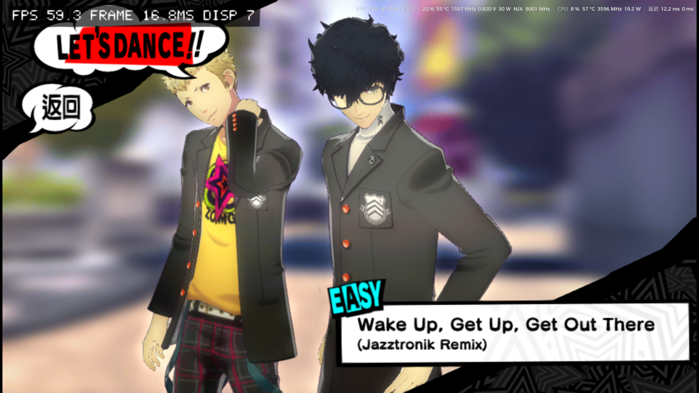 | 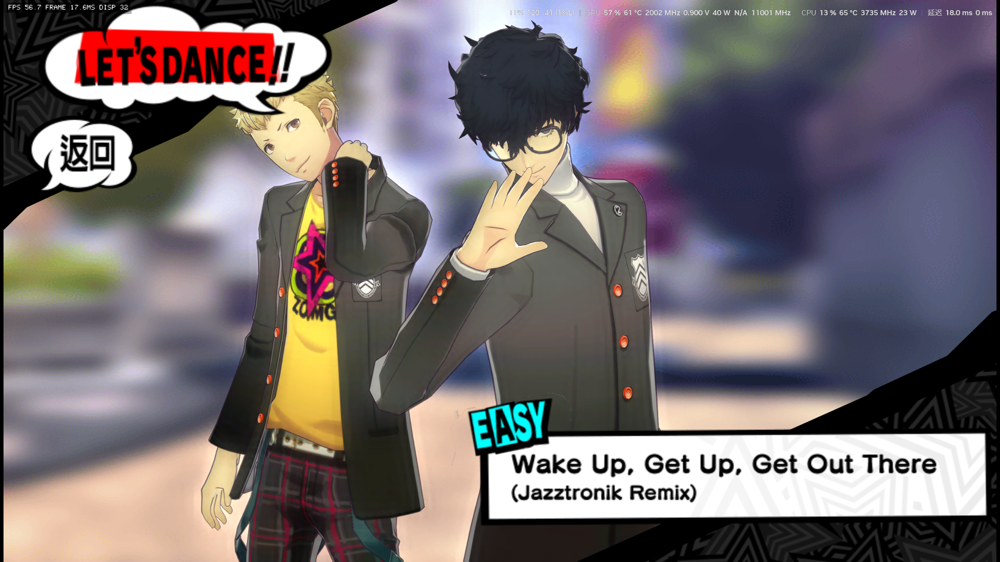 |

- **原生 60 帧**：舞池可切换 60 帧（标题／菜单保持原版 30 帧节奏）；时间轴按真实时间推进，不加速、不影响判定。
- **NVIDIA AI 插帧**：支持 NVIDIA Smooth Motion（RTX 40/50 + NVIDIA App），启动器自动检测并修复驱动条目；
  实测 30 帧设定下显示帧数 29.8 → 56.0 张/秒。这是驱动级 AI 插帧，不是 DLSS 帧生成。
- **动态亮丽（Dynamic Vibrance）**：内置自适应饱和度增强，0–100% 可调；低饱和颜色提升多、已饱和颜色几乎不动，肤色与白色不会溢色。

  | 动态亮丽 0%（关闭） | 动态亮丽 50% | 动态亮丽 100% |
  |---|---|---|
  | 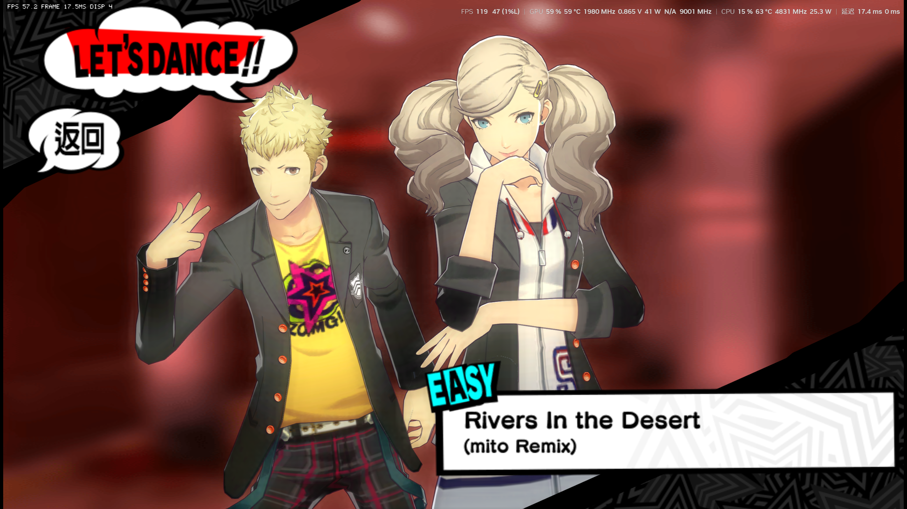 | 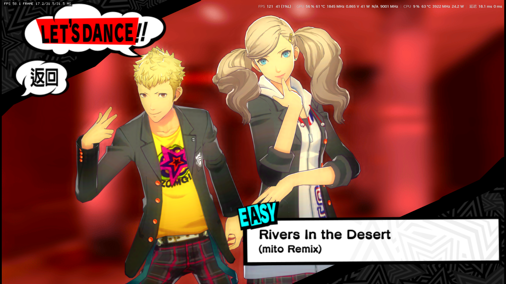 | 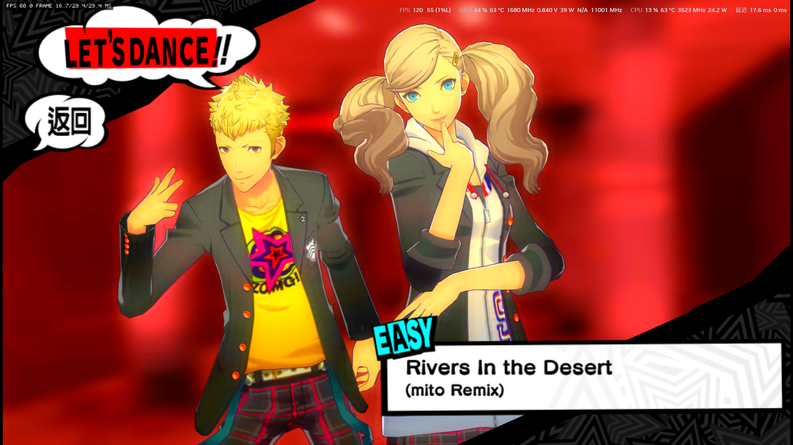 |

- **DLC 支持**：启动器可导入追加内容（`reAddcont/PCSH10109`），显示已导入数量／大小，可一键移除；不导入不影响本体。
- **游戏构建后存放位置可自定义**：启动器「其他設置 → 遊戲存放位置」可把构建后的游戏、存档、固件与 MOD 放到任意文件夹（记住选择；不选则用默认位置；改到空文件夹时会把现有游戏库连同存档一起移动过去（同盘瞬间；跨盘逐档移动，不占双份空间））。该功能在游戏构建完成后才可用。
- **MOD 支持**：兼容 Reloaded-II 格式 MOD（`Mod.xml` + `Data/` 文件夹）；启动器内导入、显示封面／名称／作者／版本，
  逐个开关并持久化；启用后启动游戏自动替换 CPK 内同名资源。已用社区泳装 MOD 与自制裸体 MOD 实测模型替换成功。

  | 使用 MOD 前（原版服裝） | 使用 MOD 後（Last Surprise Swimwear · Haalyle） |
  |---|---|
  | 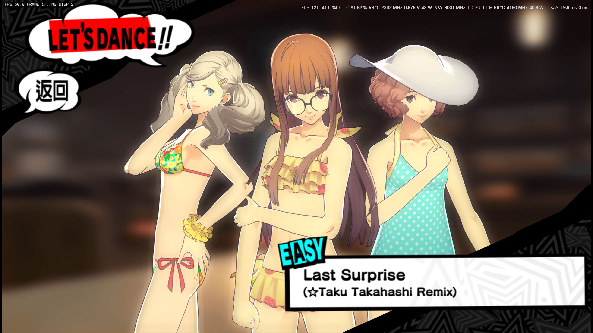 | 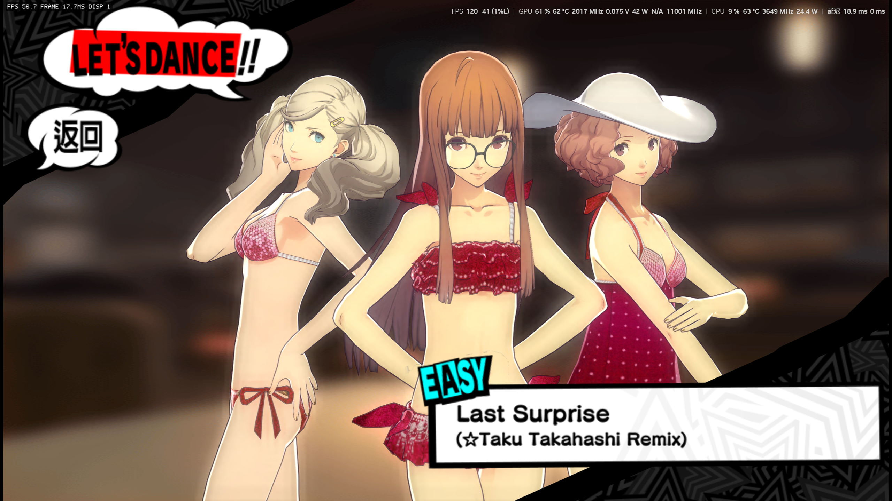 |

  *示例：社区 MOD「Last Surprise Swimwear」by **Haalyle**（来源：<https://gamebanana.com/mods/323588>）——本仓库/发布包**不附带**该 MOD，玩家下载后可在启动器「MOD」页自行导入并启用。*

  | 移植者凯梦自制 MOD 實機效果：P5D 女角色裸體模組（杏／真／春／雙葉 · 泳裝替換） |
  |---|
  | 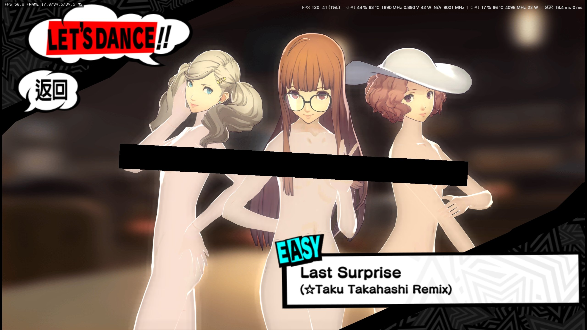 |

  *示例：移植開發時自製的 MOD「P5D 女角色裸體模組」——把四位女性角色的泳裝模型替換為裸體模型，用啟動器「MOD」頁
  導入後啟用即可生效（上圖為實機截圖）。該 MOD 的模型與貼圖均衍生自遊戲原版資源，**本仓库/发布包不附带**，
  請玩家自備遊戲本體或取得該 MOD。*

  MOD 仓库／说明与下载：<https://github.com/kaimeng114514/psv-p5d-female-nude-mod>

- **一键导入 Steam**：游戏构建完成后，启动器「其他設置 → Steam → 添加到 Steam 庫」可以**一键把本移植版加入 Steam 庫**——
  自动写入非 Steam 快捷方式（含稳定入口，启动器以后更新也不会失效），并从玩家自己构建出的游戏文件**自动生成并写入竖版封面、宽幅头图与详情页背景**；
  之后即可在 Steam 里启动（Steam 覆盖层、游戏时长统计）。桌面启动器仍然可以照常使用。

  | Steam 庫中的「P5D Windows移植版」圖示 | Steam 遊戲詳情頁（自動生成的背景與封面） |
  |---|---|
  | 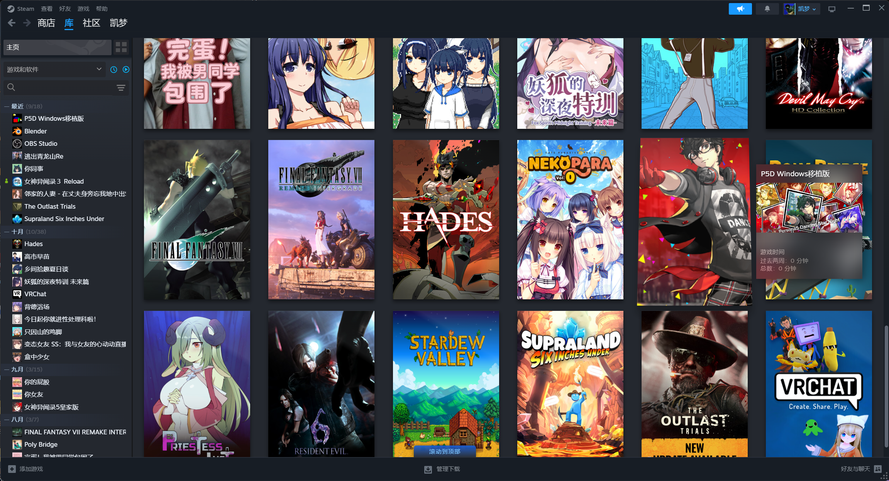 | 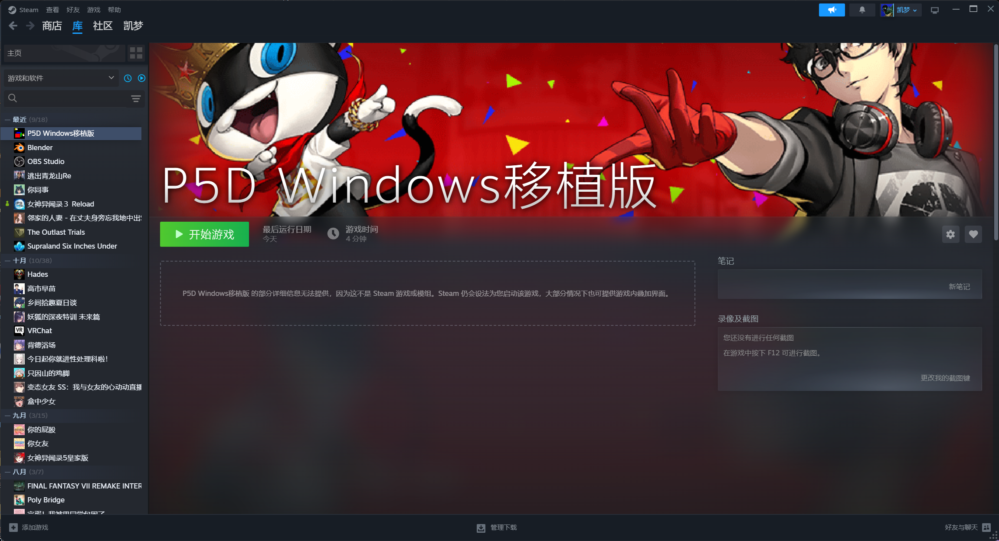 |

  *说明：不支援 Steam 的手柄配置（Steam Input）映射——手柄使用游戏内建支援；添加前请先完全退出 Steam（Steam 退出时会覆写快捷方式文件）。*

- **金手指（内置）**：
  - **F5**：自动演奏（开启/关闭，画面上方显示提示框）；
  - **F6**：一键解锁 COMMUNITY 事件、全支援与挑战、歌曲记录全满（顶部 P5 风格提示框显示 1 秒）。
- **手柄支持**：DualShock 4 / DualSense、Switch Pro / Joy-Con 的按键提示自动切换；舞曲中按节奏震动。

  | Switch Pro / Joy-Con | DualShock 4 / DualSense | Xbox 手柄 | PC 键盘 |
  |---|---|---|---|
  | 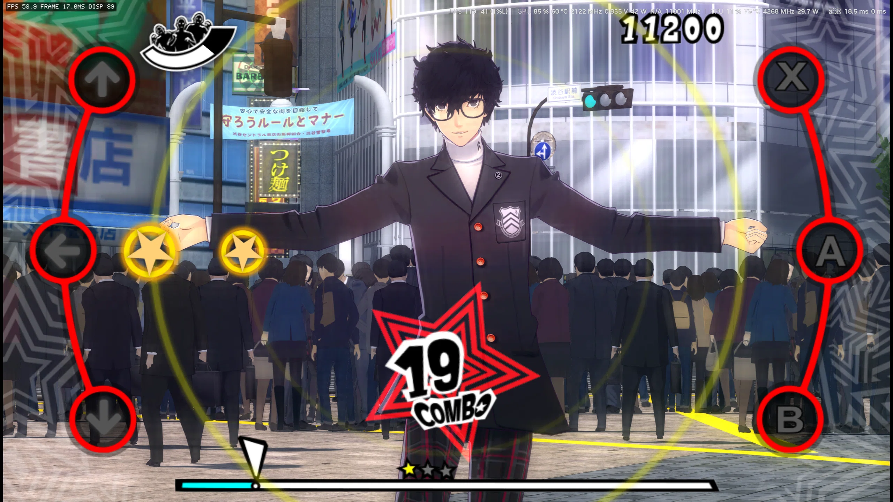 | 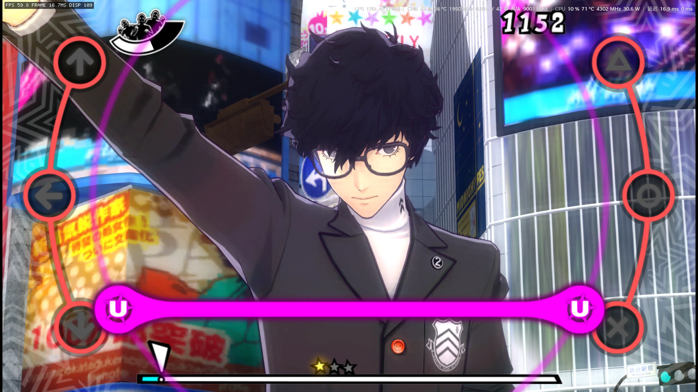 | 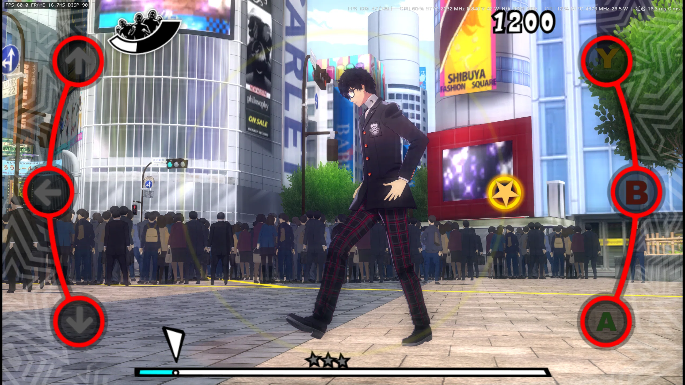 | 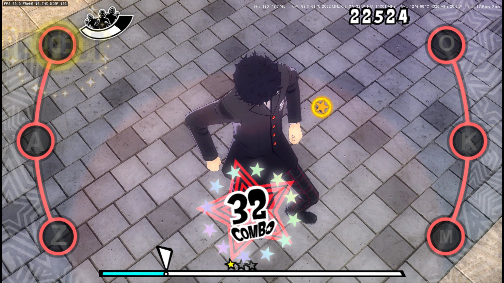 |


---

## ✅ 完整通关验证

移植者本人已用本移植版完整通关并连续游玩，全程稳定、未出现闪退。下图为通关后的制作人员名单截图：

| 通关后制作人员名单（实测截图） |
|---|
| 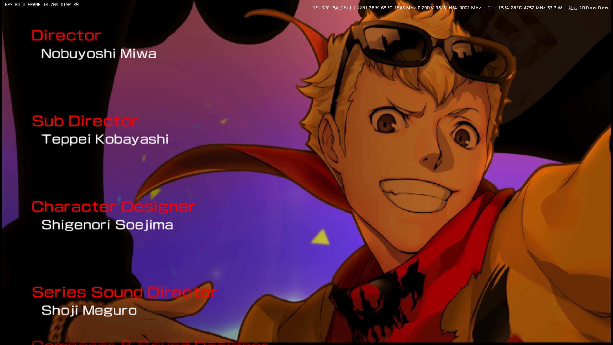 |

---

## 🚀 快速开始（单文件启动器）

下载/拿到 **`P5D Windows移植版启动器.exe`**（约 300 MB，自解压）后：

1. **双击运行**。首次会解包运行时（~1 分钟，黑底进度条），然后出现启动器。
2. **游戏 ROM**：目前**仅确定支持 MaiDump 格式**的游戏文件夹（含 `eboot.bin` 与 `data/`）；`PKG` 及其他格式的游戏 ROM **尚未测试**，不保证可用。
3. **系统固件**：选择 `PSVUPDAT.PUP` 3.74，或已解密的固件文件夹（`version.txt`、`os0/`、`vs0/`）。
4. **开始构建**：依次解密 → 分析 → 重编译 → 编译（**首次 10–30 分钟**，启动器显示真实百分比进度；之后启动秒进）。
5. **分辨率**（「畫質選項（含 **動態亮麗/Dynamic Vibrance** 滑條：0–100%，關=0）」頁）：原版 960×544 / 720p / 1080p / 2K 2560×1440 / **4K 3840×2160**。选择会同时决定**内部渲染倍率**
   （4K=4x、2K=3x、1080p=2x），原版 960×544 的布局/数值不变，只是按倍率提升渲染精度；显示器小于所选分辨率时输出会自动
   限制为桌面尺寸（2K 屏上选 4K = 4x 超采样，画面不会超出屏幕）。
6. **帧率**（「畫質選項」頁）：30 帧（原版节奏）/ 60 帧（舞池 60 帧；标题/菜单保持原版 30 帧节奏，不会加速——舞池 60 帧已实测：时间轴按真实时间推进、无倍速）。
7. **画面帧率显示**（「主頁」）：勾选后在画面左上角显示实时帧率。第一行是 `FPS 30.0 FRAME 33.3MS DISP 48`——**FPS 是游戏真实渲染帧数，DISP 是实测「游戏窗口每秒真正显示了多少张不同画面」**（由屏幕采集测量，包含 NVIDIA 驱动 AI 插帧生成的帧；30 帧设定约 48–56、60 帧设定约 107，上限为显示器刷新率）。没有估算值。
8. **AI 插帧（可选，已修复）**：「畫質選項」頁的 **AI 插帧** 会检测显卡/驱动并显示游戏程序路径；把该路径加到 NVIDIA App
   （图形 → 程式设定 → 添加程序）→ 驱动程式设定 → **AI 插帧**（英文 Smooth Motion）= 开。这是 NVIDIA 驱动级 AI 插帧
   （RTX 40/50；本移植是 Vulkan 程序），不是 DLSS 帧生成。
   **NVIDIA App 会把该程序的驱动配置条目写成错误路径（实测），导致插帧不生效；启动器在每次启动游戏前会通过 NVAPI
   自动修复这个条目**（面板会显示「驱动档案」状态）。修复后用外部截屏探针实测：30 帧设定 **29.8 → 56.0 张/秒**、
   60 帧设定约 **107 张/秒**（受 165Hz 面板上限），即 AI 插帧真实生效；游戏节奏/音乐/判定仍是真实 30/60。
   「启用 AI 插帧支援（30 帧设定也有效）」这个选项决定呈现节奏（只送真实帧，便于驱动插帧）；NVIDIA 覆盖层显示插帧
   后帧率，游戏内 F1 显示的仍是真实渲染 30/60。
9. **追加内容（DLC，可选）**：「主頁」的 **③ 追加內容（DLC，可選）** 选「選擇 DLC 文件夾…」，选你的
   `reAddcont` 文件夹（内含 `PCSH10109`）或其中的 `PCSH10109` 文件夹，启动器会把追加内容复制进游戏库（进度条），
   显示已导入的数量/大小；「移除全部 DLC」可删除。不导入也不影响本体。
10. **启动游戏**（「主頁」底部按钮）。

启动器主界面分四个标签页：**主頁**（游戏 ROM / 系统固件 / 开始构建 / 画面帧率显示 / 启动游戏）、**畫質選項**（分辨率 / 帧率 / AI 插帧 / 动态亮丽）、**金手指**（F5 自动演奏、F6 一键解锁说明）、**MOD**（Reloaded-II 格式 MOD 导入与管理）。

所有构建都在你自己的电脑上完成，不上传任何数据。游戏数据与存档保存在
`%LOCALAPPDATA%\P5D-Port\P5D\library`；共享设置（分辨率倍率/全屏/帧率等）在
`%APPDATA%\P5D-Port\P5D\settings.ini`。

> **更新启动器后**：启动器会自动发现构建过期并在下次启动时**重建一次**（会显示进度条），之后恢复秒进。

## 📦 源码


- **源码快照**：[`src/`](src/) —— 移植工程源码（当前已与开发线 **v0.2.2** 对齐；含 pipeline / recompiler /
  runtime / decrypt / packs / third_party / launcher / dev）。即使本地工程被删除，也可以从本仓库恢复并重新构建。
- 按发布红线，`src/` 不含图片资源（启动器图标/背景等，见 [`src/ASSETS_EXCLUDED.txt`](src/ASSETS_EXCLUDED.txt)）；从发布版 exe 解包后可恢复。
- 仓库**不含**游戏数据、固件、解密产物或工具链二进制；这些由玩家自备。

### 键盘操作

| 场景 | 按键 |
|---|---|
| 菜单通用 | 方向键移动，滚轮=列表上下，左键=确认，右键=返回；Enter/空格=确认，Backspace=返回，Esc=暂停 |
| 社群界面（角色列表/剧情列表） | **Q/E = L/R 肩键**（切换角色等） |
| 选歌界面 / 设置页 | **Q/E = 十字键左右**（切难度/改数值） |
| 舞池 | **Q/A/Z** = 上/左/下，**D** = 右；**O/K/M** = △/○/×，**J** = □；**Space** = 刮盘；**Esc** = 暂停 |
| 辅助 | **F1** 显示状态；**F11** 重新加载 `input.ini`；**F3** 切换 Q/E 模式（见下） |
| COLLECTION 观赏模式（角色 → 服装 → Enter） | **WASD = 左摇杆（移动）**，**方向键 = 右摇杆（旋转）**，**鼠标滚轮 = 缩放**，**Alt = 重置**；Enter = 开始/退出观赏，Ctrl = △（随机服装） |

> **Q/E 兜底**：如果某个界面 Q/E 映射不符合预期，按 **F3** 循环切换 Q/E 模式
> （`自动` → `L/R 肩键` → `D-pad 左右`），屏幕会提示并记住选择。

**手柄**：即插即用；使用手柄时游戏内提示图标会恢复原版手柄键帽。

## 与 Vita3K 模拟器的区别

本项目不是模拟器，而是**把原版 P5D 的 ARM 代码静态重编译（AOT）成 x86-64 原生程序**，Sony 的系统库也从固件重编译成本地代码、由本地兼容层（HLE）接管。两者的定位与实现不同：

| 项目 | 本项目（P5D PC 原生移植） | Vita3K（PS Vita 模拟器） |
|---|---|---|
| 运行方式 | 原版 ARM 代码 **AOT 静态重编译**为原生 x86-64 程序；系统库重编译 + HLE 接管文件/内存/线程/GXM/音频/输入/视频 | **模拟器**：软件模拟 Vita 的 CPU/GPU/系统，在模拟环境里运行原版程序 |
| 执行开销 | 游戏逻辑直接跑在你的 CPU 上，没有逐指令模拟/翻译循环（首次构建后启动即原生执行） | 需要模拟 CPU 与 GPU，指令与状态翻译有持续开销 |
| 目标 | **只针对 P5D（PCSH10109 1.00）**：为这一款游戏做键鼠、分辨率、镜头等适配 | 通用模拟器：面向大量 PSV 游戏，不做单游戏界面/输入适配 |
| 输入 | 全界面 PC 键鼠映射（主菜单/选歌/打歌/暂停/设置/社群/结算/COLLECTION 观赏），游戏内提示图标替换为 PC 键位；手柄即插即用 | 以模拟手柄/触摸为主；键鼠映射是通用方案，不针对本作界面设计 |
| 画面/数值 | 原版游戏代码自己绘制（HLE 层不含游戏画面内容）；可选 960×544/720p/1080p/2K，内部渲染倍率 1x–3x，原版布局/数值不变 | 原版游戏在模拟器中绘制；也有分辨率/渲染增强选项 |
| 使用流程 | 需要**首次在本机构建**（解密 → 分析 → 重编译 → 编译，约 10–30 分钟），之后原生启动、秒进 | 安装固件后直接加载游戏，无需构建；但每次运行都经过模拟 |
| 存档/数据 | 构建库与存档由本项目管理（`%LOCALAPPDATA%\P5D-Port\P5D`），与模拟器存档不互通 | 使用 Vita3K 自己的模拟存储/存档目录 |
| 依赖 | 构建出的是独立 Windows 原生程序，不依赖模拟器 | 依赖 Vita3K 程序与固件 |
| 许可/来源 | 基于 [nativ](https://github.com/TheLostPantheon/nativ)（GPL-2）架构的 P5D 专用移植 | 独立的开源模拟器项目 |

补充说明：

- 两者都要求玩家**自备游戏拷贝与 PS Vita 3.74 固件**，仓库与发布物不含游戏数据；
- **存档不互通**：本移植版存档在 `%LOCALAPPDATA%\P5D-Port\P5D\library`，Vita3K 的存档在其自己的用户目录，迁移需要额外工具（暂未提供）；
- 本项目**不能**运行其它 PSV 游戏，也不支持 P5D 的其它版本/区域；需要通用模拟请使用 Vita3K；
- 两者的画面都是原版游戏代码绘制，区别在"如何去执行原版代码"：本项目是重编译后的原生执行，Vita3K 是运行时的模拟执行。

---

## 架构（当前实现）

```
玩家自备 P5D 数据（eboot + data.cpk/vita.cpk）+ PS Vita 固件（自备）
        │
        ▼
  nativ 架构工具链（本机）
    ├─ analyze/recompile：原版 eboot → x86-64 C 代码（AOT，本机生成）
    ├─ analyze/recompile：Sony libgxm/libc/libfios2/libgpu_es4（固件）→ x86-64
    └─ build：链接 内核/图形/输入/音频/视频 HLE 层 → game_host.exe
        │
        ▼
  运行时 HLE：线程/同步、内存、文件（app0→本地目录、CPK）、输入、音频、视频、显示
        │
        ▼
  GXM 状态观察（libgxm_es4 原生运行）→ API 中立 GfxDraw
        │
        ▼
  Vulkan GPU 后端（SDL3 GPU）→ 交换链/玩家窗口
```

> 当前工程基于 GPL-2 的 [nativ](https://github.com/TheLostPantheon/nativ) 架构与部分 GPL-2 参考
> （Vita3K 等）。归属说明见 [NOTICE.md](NOTICE.md) / [THIRD_PARTY_NOTICES.md](THIRD_PARTY_NOTICES.md)。

## 🤖 AI 辅助开发说明

本项目的开发过程中使用了 **AI 辅助工具**：以下三种 AI **均实际参与了程序开发**（代码生成与审查、构建与运行问题定位、方案设计等），同时也在文档撰写、资料整理与文本润色上提供辅助。

| AI 工具 | 参与的工作 |
|---|---|
| **DeepSeek** | **程序开发**：代码生成/审查、构建与运行问题定位、方案设计；文档整理、知识库记录 |
| **通义千问（Qwen）** | **程序开发**：代码生成/方案设计与问题排查；资料整理、文本辅助 |
| **豆包（Doubao）** | **程序开发**：代码生成/方案讨论与调试辅助；文本润色、资料整理 |

说明：

- AI 是**实际参与开发**的工具，但最终结果由移植者负责：所有代码、配置与文档在发布前均经过人工审查、编译验证与实机测试，不过 AI 仍可能产生错误、过时或不准确的内容，本项目不保证全部内容绝对无误；
- 本项目中的第三方代码、密钥数据与资源均按各自许可与来源标注（见 [NOTICE.md](NOTICE.md) / [THIRD_PARTY_NOTICES.md](THIRD_PARTY_NOTICES.md) 及本文各节），**AI 辅助不改变任何内容的版权归属**；
- AI 辅助工具及其提供方与本项目**没有隶属、赞助、授权或合作关系**，本项目由移植者个人维护；
- 如发现 AI 辅助产生的错误说明、不当内容或疑似侵权片段，可通过本仓库 Issues 反馈，我们会核实并修正。

## 发布合规与版权

- 发布树红线（不含游戏可执行码/资源/着色器衍生数据/密钥固件）见
  [docs/RELEASE_COMPLIANCE.md](docs/RELEASE_COMPLIANCE.md)。
- `docs/screenshots/` 仅为开发进度截图（由本项目运行时输出、版权归 ATLUS/SEGA，可应要求移除）；
  `tools/release_audit.py` 对其显式允许，其余 `.png/.bmp` 仍按红线拒绝。
- 本仓库以 **GPL-2** 发布。

## 测试人员致谢

v0.1.0 的键鼠适配、界面键位与构建流程能走到今天，离不开参与测试的玩家朋友们。特别感谢以下测试人员（按提供顺序）：

| 测试人员 | 主页 |
|---|---|
| **lris舒** | <https://b23.tv/gu15QzD> |
| **空條** | <https://b23.tv/tjUa3Qf> |
| **wufe** | <https://b23.tv/Vn35gnF> |

感谢他们在 v0.1.0 期间参与实机测试与游玩反馈，帮助我们验证键鼠操作、界面流程与启动器构建体验。测试过程中发现的具体问题由开发者在各自验证环节定位与修复；以上名单仅为参与测试的致谢，不代表其对某一具体问题的验证。

## 致谢

- [Project Nativ](https://github.com/TheLostPantheon/nativ)（GPL-2）：AOT 重编译 + Sony 用户库重编译 + GPU 抽象架构
- [Vita3K](https://github.com/Vita3K/Vita3K)（GPL-2）：GXM/AVC/文件系统语义参考
- 以及所有 PS Vita 逆向工程社区的资料与工具
